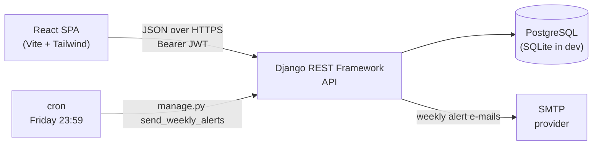

# Architecture Overview

🇧🇷 [Português](pt-br/architecture.md) | 🇺🇸 **English**

GEICIS Ponto is a web system for tracking internship hours. It was designed
before implementation so that the domain model, the business rules, and the API
contract are all decided in writing rather than discovered while coding.

## High-Level Architecture

Classic client–server split, communicating exclusively over a REST API:



- **Frontend** — user interaction and API consumption only.
- **Backend API** — every business rule, every validation, every permission check.
- **Database** — persistence and relational integrity.
- **Scheduler** — a single weekly job, triggered externally, not a daemon.

## Backend Responsibilities

The Django backend owns:

- Authentication and token issuing
- Role-based authorization (student / professor / coordinator)
- Clock-in and clock-out validation, including the single-open-entry rule
- Worked-hour computation and the ranking query
- Weekly minimum evaluation and alert dispatch
- Referential integrity between students, professors, and internships

No business rule is enforced exclusively on the frontend. The frontend is
treated as an untrusted client: it may hide a button, but the API still refuses
the request.

## Roles

Three roles, stored on the `User` record and carried in the JWT payload:

| Role          | Can do                                                                     |
| ------------- | -------------------------------------------------------------------------- |
| `STUDENT`     | Clock in/out, see own history and summary, see the ranking                 |
| `PROFESSOR`   | Everything a student sees, plus read and correct entries of supervised students |
| `COORDINATOR` | Full access: manage internships, students, professors, supervisions, alerts |

`COORDINATOR` maps to Django's `is_staff`, so the same account reaches the admin.

## Data Model

The domain entities are:

- `User` — the authentication record, one per person
- `StudentProfile` — the student side of a user, holds the hour targets
- `ProfessorProfile` — the professor side of a user
- `Internship` — a placement/host organization, shared by several students
- `Supervision` — the many-to-many join between professors and students
- `TimeEntry` — one clock-in/clock-out pair
- `WeeklyAlert` — the record of a weekly warning e-mail that was sent

Fields and constraints are specified in [data-model.md](data-model.md), and drawn
in [diagrams/er-diagram.md](diagrams/er-diagram.md) and
[diagrams/class-diagram.md](diagrams/class-diagram.md).

## Main Flows

Four flows were modeled and are documented in
[diagrams/sequence-diagrams.md](diagrams/sequence-diagrams.md):

1. **Registration** — a student signs up, picks an internship, declares the total
   required hours and the weekly minimum.
2. **Clock in / clock out** — the central interaction, deliberately two buttons.
3. **Ranking load** — aggregate hours per student, ordered descending.
4. **Weekly alert** — Friday at 23:59, find who missed the weekly minimum, e-mail them.

## Project Layout

Mirrors the structure of the `social-network` project:

```
geicis-ponto/
├── backend/
│   ├── config/
│   │   ├── settings.py
│   │   ├── urls.py
│   │   ├── auth.py            # token endpoints
│   │   ├── asgi.py
│   │   └── wsgi.py
│   ├── apps/
│   │   ├── users/             # User, StudentProfile, ProfessorProfile, Supervision
│   │   ├── internships/       # Internship
│   │   └── timesheet/         # TimeEntry, WeeklyAlert, ranking, alert command
│   ├── manage.py
│   ├── requirements.txt
│   └── .env.example
├── frontend/
│   ├── src/
│   │   ├── api/               # axios client, interceptors, endpoint modules
│   │   ├── components/
│   │   ├── pages/
│   │   ├── hooks/
│   │   ├── context/           # auth context
│   │   ├── App.jsx
│   │   └── main.jsx
│   ├── index.html
│   ├── tailwind.config.js
│   ├── vite.config.js
│   └── package.json
└── docs/
```

Three Django apps rather than one, split by domain rather than by technical
layer. `timesheet` is where the interesting logic lives and it stays separable
from identity concerns.

## Authentication

Identical to the `social-network` project: `rest_framework_simplejwt`, access
token valid for 1 hour, refresh token for 7 days, `Authorization: Bearer <token>`.
Passwords are hashed by Django (PBKDF2) and validated by the four standard
validators. Details and the hardening deltas are in [api.md](api.md#authentication)
and [decisions.md](decisions.md#authentication).

## Time and Scheduling

`USE_TZ = True` and `TIME_ZONE = 'America/Sao_Paulo'`. All timestamps are stored
in UTC and rendered in local time. This matters more than it looks: "Friday at
23:59" and "which week does this entry belong to" are both local-time questions,
and getting them wrong silently shifts entries between weeks.

The weekly alert is a management command, `python manage.py send_weekly_alerts`,
invoked by cron at `59 23 * * 5`. It is idempotent — see
[business-rules.md](business-rules.md#weekly-alert).

## Deployment

| Concern       | Development         | Production                          |
| ------------- | ------------------- | ----------------------------------- |
| Database      | SQLite              | PostgreSQL                          |
| Static files  | Vite dev server     | `collectstatic` behind a web server |
| Secrets       | `.env`              | environment variables               |
| `DEBUG`       | `True`              | `False`                             |
| E-mail        | console backend     | SMTP                                |
| Scheduler     | run manually        | cron                                |

## API

The complete REST surface — endpoints, payloads, permissions, and the rules each
one enforces — is in [api.md](api.md).
