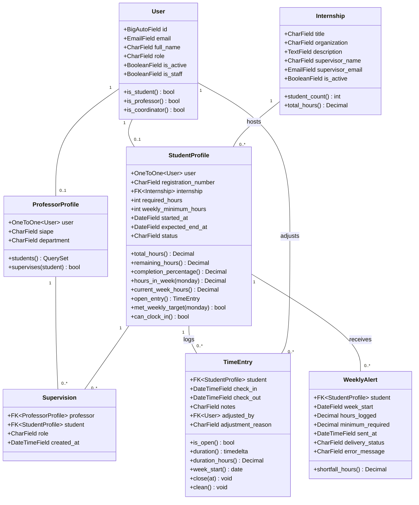
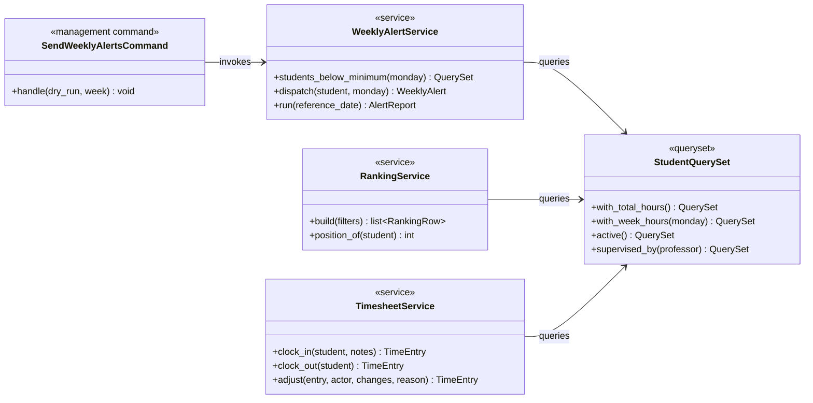

# Class Diagram

Domain classes with the behaviour attached to them. Persisted fields are in
[../data-model.md](../data-model.md); this diagram is about where logic lives.

## Service layer

The pieces that do not belong on a single model, because they coordinate several
or talk to the outside world:

Three notes on the shape of this:

- **`StudentQuerySet` is where the hour arithmetic lives.** `with_total_hours()`
  and `with_week_hours()` are annotations, so the ranking, the summary, and the
  weekly job all sum hours through the same SQL rather than three near-identical
  Python loops that drift apart.
- **`TimesheetService.clock_in` still catches `IntegrityError`.** It checks for an
  open entry first for a clean error message, but the partial unique index is the
  real guarantee, and the code is written expecting the database to win a race.
- **`SendWeeklyAlertsCommand` holds no logic.** It parses `--dry-run` and
  `--week`, calls the service, prints a report. Everything testable sits in
  `WeeklyAlertService`, which never needs a fake cron to exercise.
