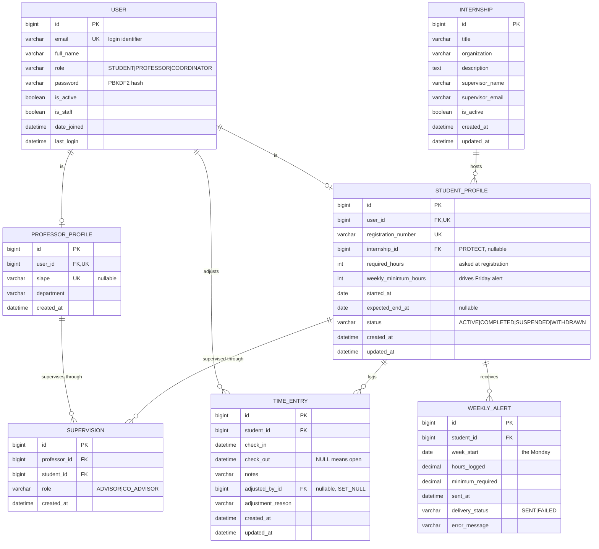
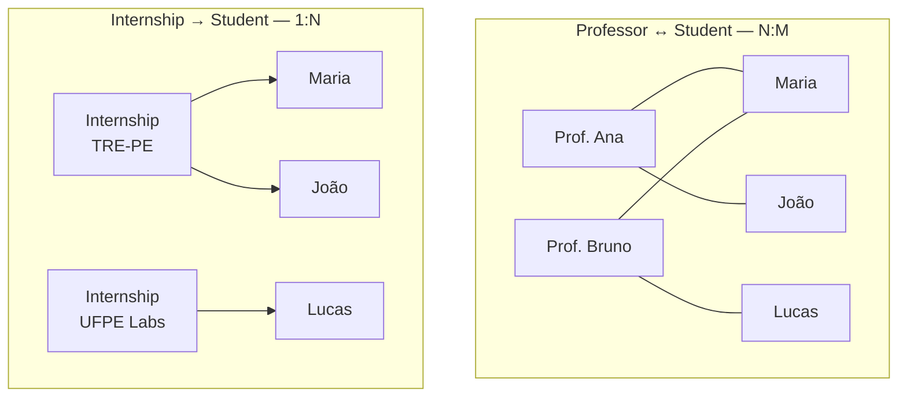

# Entity–Relationship Diagram

🇧🇷 [Português](../pt-br/diagrams/er-diagram.md) | 🇺🇸 **English**

Relational schema. Field-level rules are in [../data-model.md](../data-model.md).

## The two relationships that were specified explicitly

A professor has many students and a student has many professors, so the pair
needs the `SUPERVISION` join table. An internship hosts many students but a
student holds exactly one internship, so a single foreign key on
`STUDENT_PROFILE` is enough — no join table, and the "only one internship" rule
is structural rather than validated.

## Constraints that live in the database

These are database-level, not serializer-level. A race, a retry, or a direct
`psql` session cannot get around them.

| Table             | Constraint                                             | Protects against                     |
| ----------------- | ------------------------------------------------------ | ------------------------------------ |
| `USER`            | `unique(email)`                                        | duplicate accounts                   |
| `STUDENT_PROFILE` | `unique(registration_number)`                          | duplicate students                   |
| `STUDENT_PROFILE` | `required_hours > 0`, `weekly_minimum_hours > 0`       | nonsense targets                     |
| `STUDENT_PROFILE` | `weekly_minimum_hours <= required_hours`               | unreachable weekly target            |
| `STUDENT_PROFILE` | `expected_end_at >= started_at`                        | inverted period                      |
| `STUDENT_PROFILE` | FK `internship` `ON DELETE PROTECT`                    | orphaning hour records               |
| `INTERNSHIP`      | `unique(title, organization)`                          | duplicate placements                 |
| `SUPERVISION`     | `unique(professor_id, student_id)`                     | duplicate links                      |
| `SUPERVISION`     | partial `unique(student_id) where role='ADVISOR'`      | two main advisors                    |
| `TIME_ENTRY`      | `check_out IS NULL OR check_out > check_in`            | negative durations                   |
| `TIME_ENTRY`      | **partial `unique(student_id) where check_out IS NULL`** | two open entries from a double-click |
| `TIME_ENTRY`      | index `(student_id, check_in)`                         | slow ranking and weekly queries      |
| `WEEKLY_ALERT`    | `unique(student_id, week_start)`                       | duplicate Friday e-mails             |

The two in bold type matter most: the partial unique on open entries is what
makes clock-in safe under a double-tap, and the unique on `(student, week_start)`
is what makes the Friday job safe to re-run.
