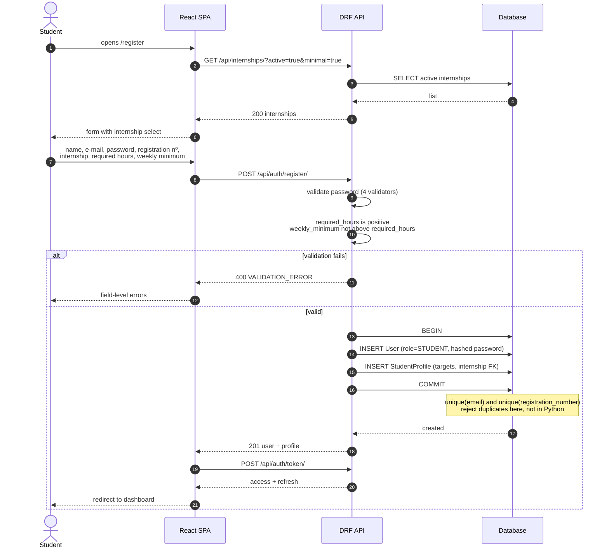
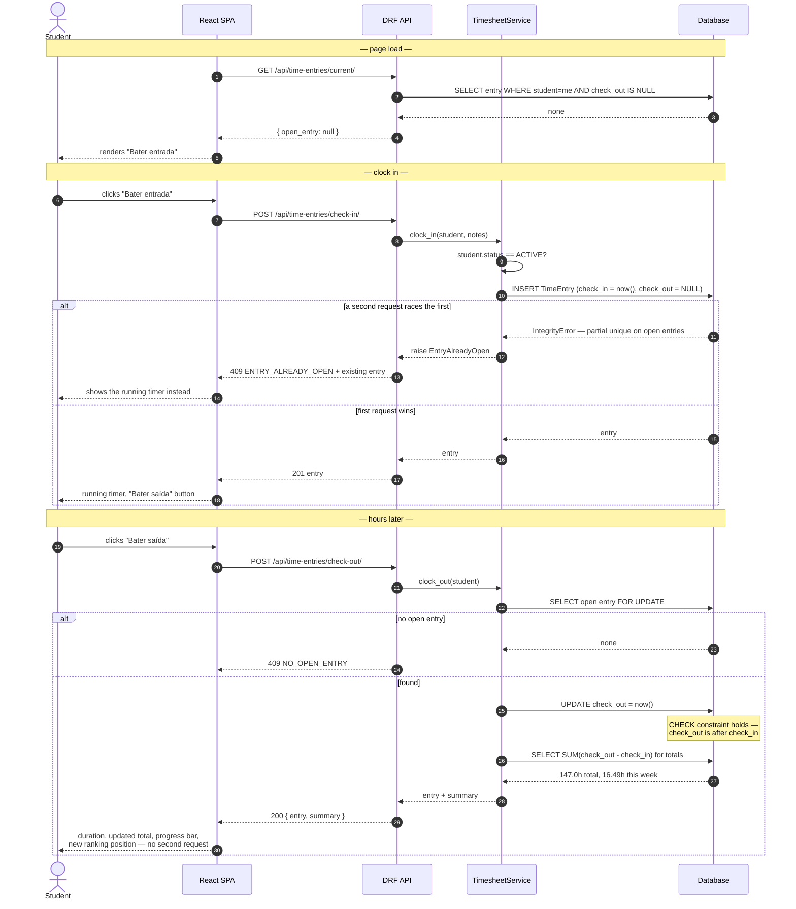
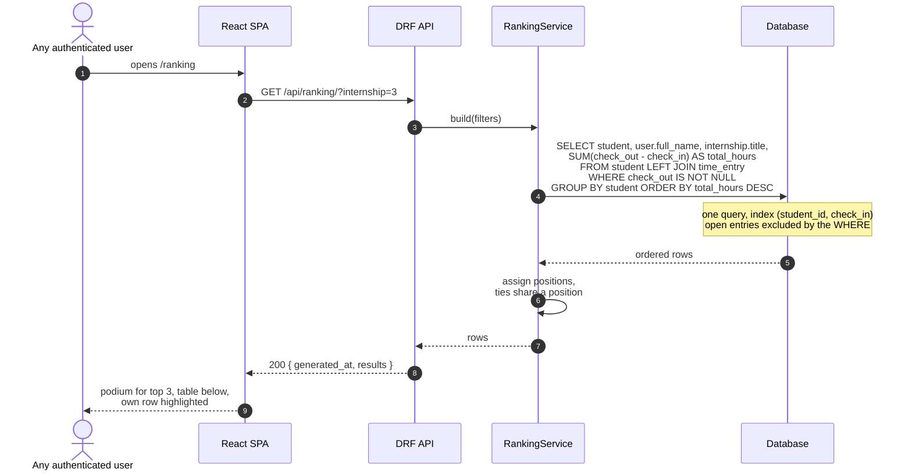
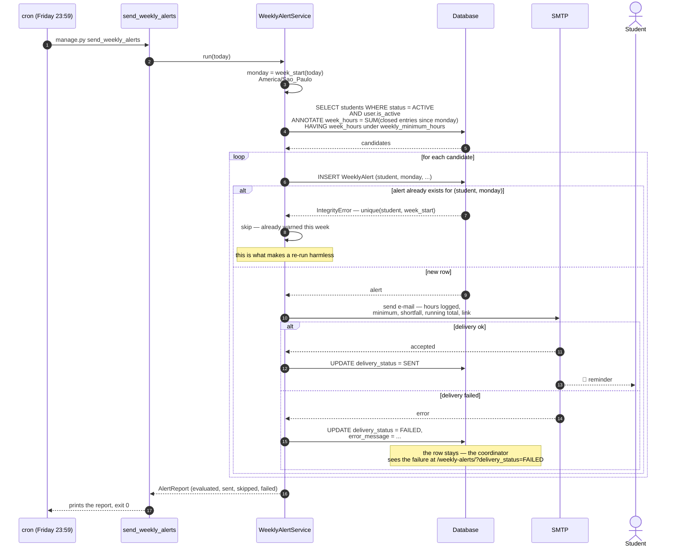
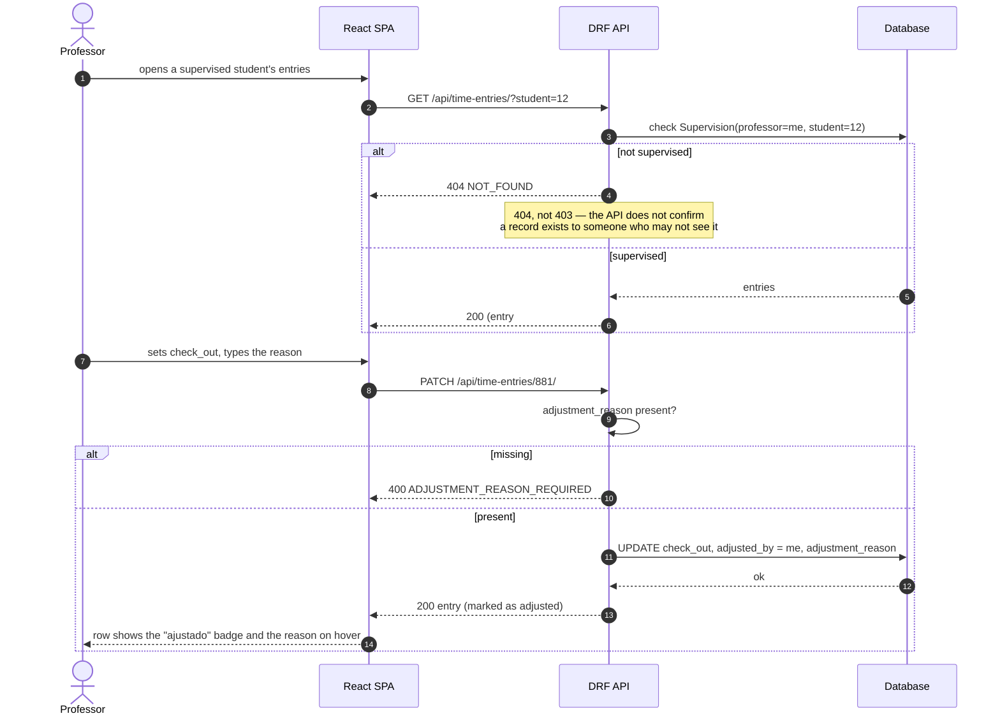

# Sequence Diagrams

The four flows that were modeled before implementation.

---

## 1. Student registration

The only flow where `required_hours` and `weekly_minimum_hours` are collected.

---

## 2. Clock in and clock out

The central interaction. Two buttons, and only ever one of them visible.

---

## 3. Ranking

---

## 4. Weekly alert — Friday 23:59

The flow the scheduler exists for.

**Why the `WeeklyAlert` row is written before the e-mail is sent:** the unique
constraint has to be claimed first. If the e-mail went out first and the process
died before the insert, a re-run would mail the student twice. In the other
order, a crash at worst leaves a row whose `delivery_status` never left its
initial value — visible, and fixable, and not a duplicate in someone's inbox.

---

## 5. Professor corrects a forgotten clock-out

