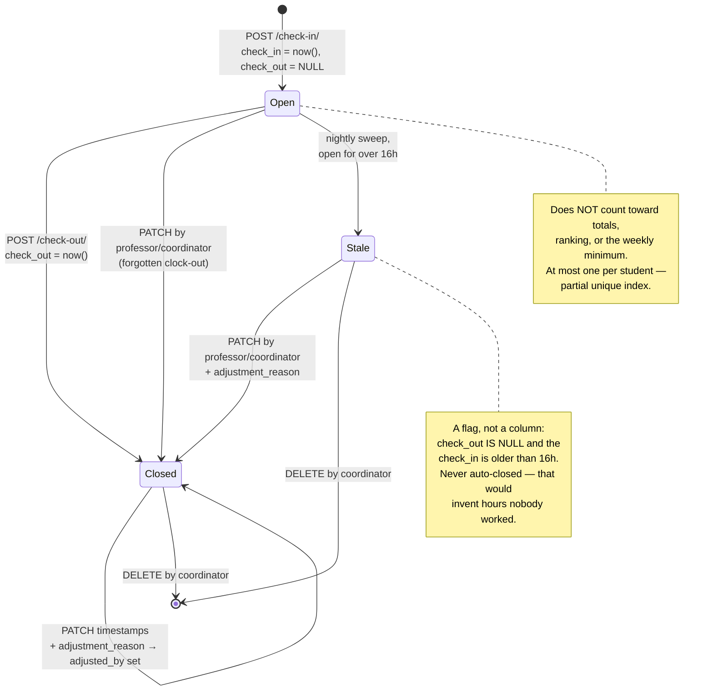
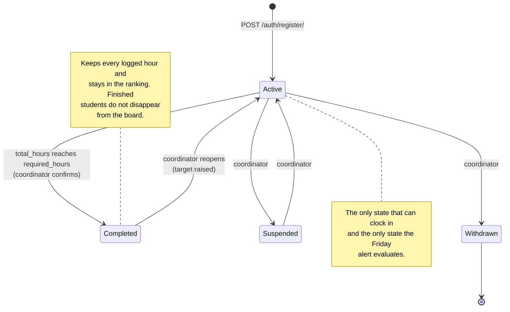
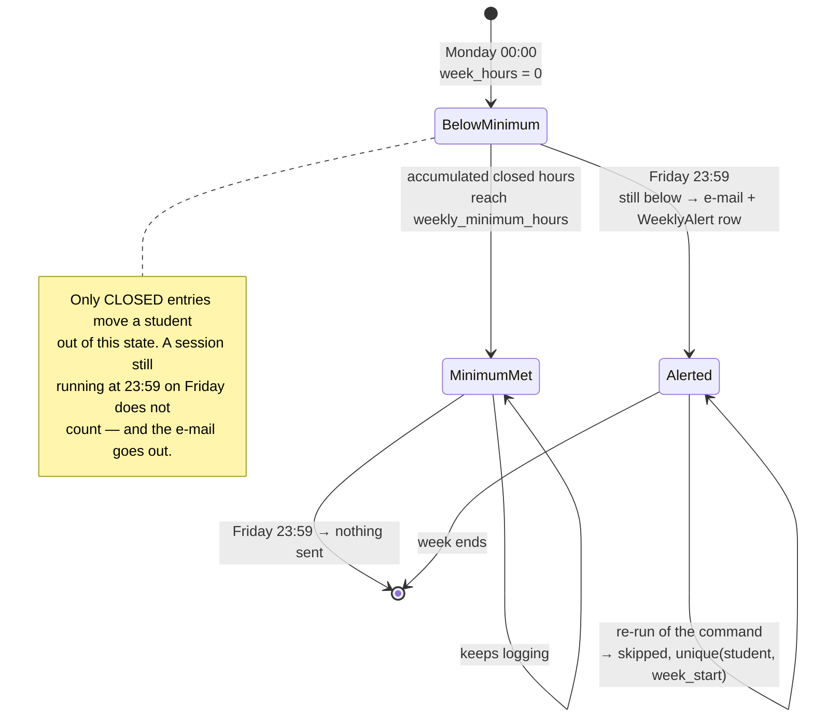

# State Diagrams

🇧🇷 [Português](../pt-br/diagrams/state-diagram.md) | 🇺🇸 **English**

## TimeEntry

An entry has two real states. The third is a flag, not a state — an adjusted
entry is still closed.

## StudentProfile

Reaching `required_hours` does **not** flip the status automatically. A
coordinator confirms it, because completing an internship is an administrative
act with paperwork behind it, and hours in the system are evidence for that
decision rather than the decision itself.

## Weekly evaluation cycle

Where a student sits within one week, from the alert's point of view.

