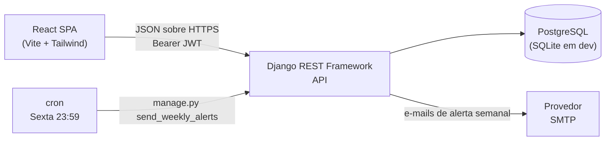

# Visão Geral da Arquitetura

🇧🇷 **Português** | 🇺🇸 [English](../architecture.md)

O GEICIS Ponto é um sistema web para controlar horas de estágio. Ele foi
desenhado antes da implementação, de forma que o modelo de domínio, as regras
de negócio e o contrato da API fossem todos decididos por escrito, em vez de
descobertos enquanto o código era escrito.

## Arquitetura de alto nível

Divisão clássica cliente-servidor, comunicando exclusivamente por uma API REST:



- **Frontend** — só interação com o usuário e consumo da API.
- **API do backend** — cada regra de negócio, cada validação, cada checagem de permissão.
- **Banco de dados** — persistência e integridade relacional.
- **Agendador** — um único job semanal, disparado externamente, não um daemon.

## Responsabilidades do backend

O backend em Django é dono de:

- Autenticação e emissão de tokens
- Autorização baseada em papel (aluno / professor / coordenador)
- Validação de entrada e saída de ponto, incluindo a regra de ponto único aberto
- Cálculo de horas trabalhadas e a query do ranking
- Avaliação do mínimo semanal e disparo de alertas
- Integridade referencial entre alunos, professores e estágios

Nenhuma regra de negócio é aplicada exclusivamente no frontend. O frontend é
tratado como um cliente não confiável: ele pode esconder um botão, mas a API
ainda recusa a requisição.

## Papéis

Três papéis, guardados no registro de `User` e carregados no payload do JWT:

| Papel         | Pode fazer                                                                  |
| ------------- | ---------------------------------------------------------------------------- |
| `STUDENT`     | Bater ponto, ver o próprio histórico e resumo, ver o ranking                 |
| `PROFESSOR`   | Tudo que um aluno vê, mais ler e corrigir registros dos alunos que orienta   |
| `COORDINATOR` | Acesso total: gerencia estágios, alunos, professores, orientações, alertas   |

`COORDINATOR` mapeia para o `is_staff` do Django, então a mesma conta acessa o admin.

## Modelo de dados

As entidades de domínio são:

- `User` — o registro de autenticação, um por pessoa
- `StudentProfile` — o lado aluno de um usuário, guarda as metas de horas
- `ProfessorProfile` — o lado professor de um usuário
- `Internship` — um estágio/instituição hospedeira, compartilhado por vários alunos
- `Supervision` — o vínculo muitos-para-muitos entre professores e alunos
- `TimeEntry` — um par de entrada/saída de ponto
- `WeeklyAlert` — o registro de um e-mail de alerta semanal que foi enviado

Campos e constraints estão especificados em [data-model.md](data-model.md), e
desenhados em [diagrams/er-diagram.md](diagrams/er-diagram.md) e
[diagrams/class-diagram.md](diagrams/class-diagram.md).

## Fluxos principais

Quatro fluxos foram modelados e estão documentados em
[diagrams/sequence-diagrams.md](diagrams/sequence-diagrams.md):

1. **Cadastro** — um aluno se registra, escolhe um estágio, declara a carga
   horária total exigida e o mínimo semanal.
2. **Bater entrada / saída** — a interação central, deliberadamente dois botões.
3. **Carregamento do ranking** — soma de horas por aluno, ordenado de forma decrescente.
4. **Alerta semanal** — sexta às 23:59, encontra quem não bateu o mínimo semanal, manda e-mail.

## Estrutura do projeto

Espelha a estrutura do projeto `social-network`:

```
geicis-ponto/
├── backend/
│   ├── config/
│   │   ├── settings.py
│   │   ├── urls.py
│   │   ├── auth.py            # endpoints de token
│   │   ├── asgi.py
│   │   └── wsgi.py
│   ├── apps/
│   │   ├── users/             # User, StudentProfile, ProfessorProfile, Supervision
│   │   ├── internships/       # Internship
│   │   └── timesheet/         # TimeEntry, WeeklyAlert, ranking, comando de alerta
│   ├── manage.py
│   ├── requirements.txt
│   └── .env.example
├── frontend/
│   ├── src/
│   │   ├── api/               # cliente axios, interceptors, módulos de endpoint
│   │   ├── components/
│   │   ├── pages/
│   │   ├── hooks/
│   │   ├── context/           # contexto de autenticação
│   │   ├── App.jsx
│   │   └── main.jsx
│   ├── index.html
│   ├── tailwind.config.js
│   ├── vite.config.js
│   └── package.json
└── docs/
```

Três apps Django em vez de um, separados por domínio em vez de por camada
técnica. `timesheet` é onde vive a lógica interessante, e permanece separável
das questões de identidade.

## Autenticação

Idêntica ao projeto `social-network`: `rest_framework_simplejwt`, token de
acesso válido por 1 hora, token de refresh por 7 dias,
`Authorization: Bearer <token>`. As senhas são hasheadas pelo Django (PBKDF2) e
validadas pelos quatro validadores padrão. Detalhes e os reforços de segurança
estão em [api.md](api.md#autenticação) e [decisions.md](decisions.md#autenticação).

## Tempo e agendamento

`USE_TZ = True` e `TIME_ZONE = 'America/Sao_Paulo'`. Todos os timestamps são
guardados em UTC e exibidos em horário local. Isso importa mais do que parece:
"sexta às 23:59" e "de qual semana é esse registro" são as duas perguntas de
horário local, e errar isso desloca registros entre semanas silenciosamente.

O alerta semanal é um comando de gerenciamento, `python manage.py
send_weekly_alerts`, invocado pelo cron às `59 23 * * 5`. Ele é idempotente —
veja [business-rules.md](business-rules.md#alerta-semanal).

## Deploy

| Aspecto       | Desenvolvimento      | Produção                            |
| ------------- | -------------------- | ------------------------------------ |
| Banco         | SQLite               | PostgreSQL                          |
| Arquivos estáticos | Servidor de dev do Vite | `collectstatic` atrás de um servidor web |
| Segredos      | `.env`               | variáveis de ambiente                |
| `DEBUG`       | `True`               | `False`                              |
| E-mail        | backend de console   | SMTP                                 |
| Agendador     | roda manualmente     | cron                                 |

## API

A superfície REST completa — endpoints, payloads, permissões e as regras que
cada um aplica — está em [api.md](api.md).
