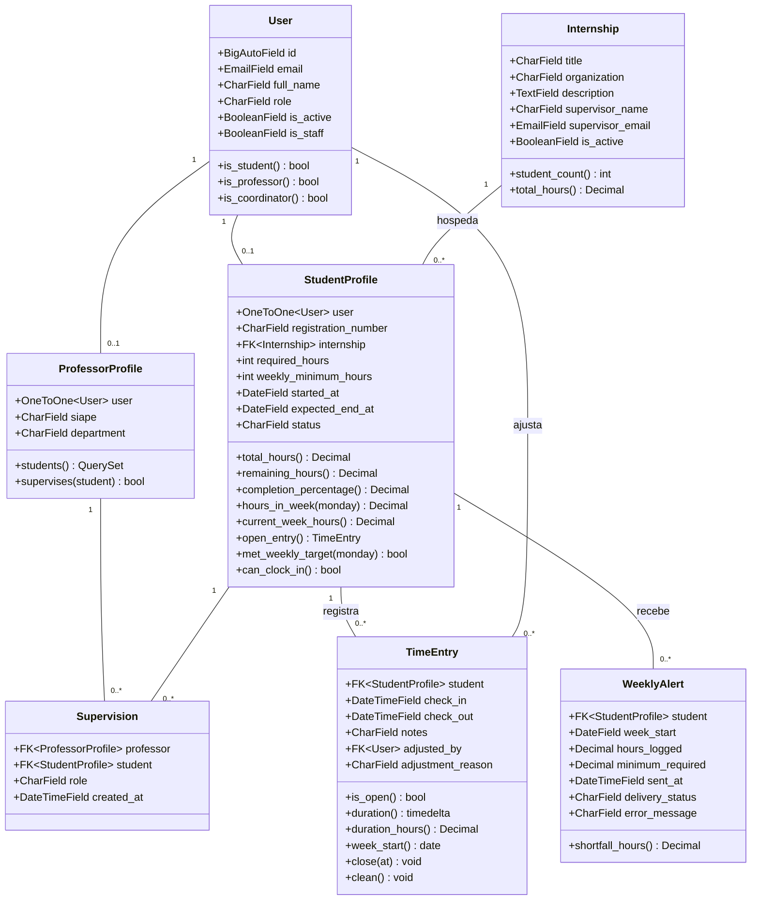
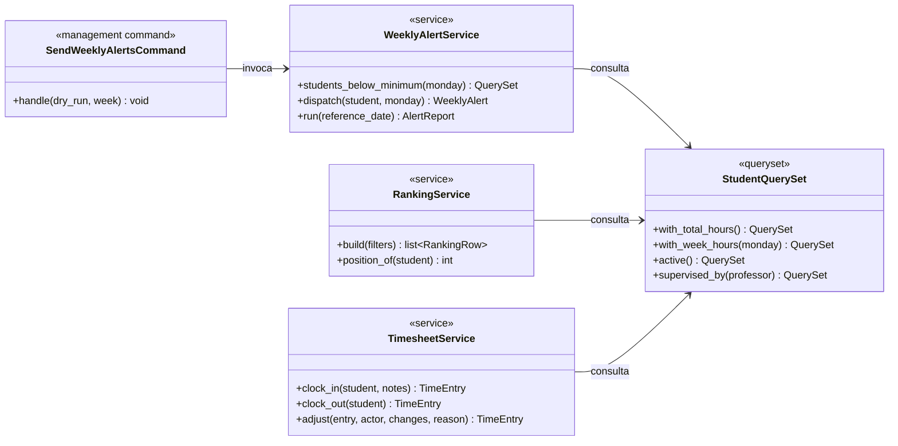

# Diagrama de Classes

🇧🇷 **Português** | 🇺🇸 [English](../../diagrams/class-diagram.md)

Classes de domínio com o comportamento associado a elas. Campos persistidos
estão em [../data-model.md](../data-model.md); este diagrama é sobre onde a
lógica vive.

## Camada de serviço

As partes que não pertencem a um único model, porque coordenam vários ou
conversam com o mundo externo:

Três notas sobre esse formato:

- **`StudentQuerySet` é onde a aritmética de horas vive.** `with_total_hours()`
  e `with_week_hours()` são anotações, então o ranking, o resumo, e o job
  semanal somam horas através do mesmo SQL, em vez de três loops em Python
  quase idênticos que iriam divergir.
- **`TimesheetService.clock_in` ainda captura `IntegrityError`.** Ele checa
  por um registro aberto primeiro para uma mensagem de erro limpa, mas o
  índice único parcial é a garantia real, e o código é escrito esperando que
  o banco vença uma corrida.
- **`SendWeeklyAlertsCommand` não guarda lógica.** Ele processa `--dry-run` e
  `--week`, chama o serviço, imprime um relatório. Tudo o que é testável fica
  em `WeeklyAlertService`, que nunca precisa de um cron falso para ser
  exercitado.
