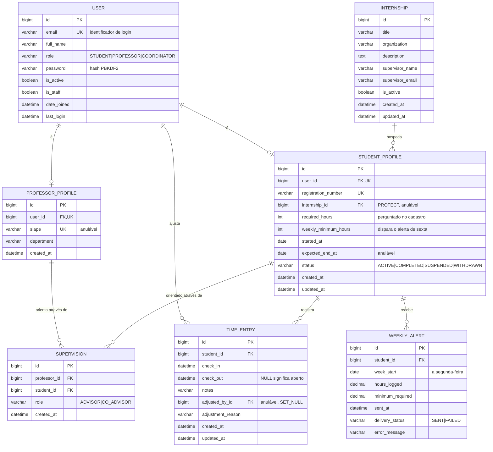
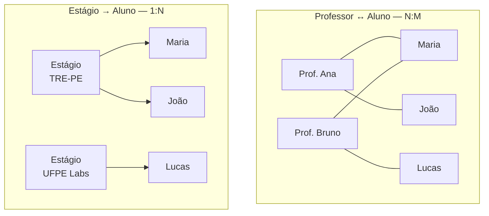

# Diagrama Entidade-Relacionamento

🇧🇷 **Português** | 🇺🇸 [English](../../diagrams/er-diagram.md)

Esquema relacional. As regras a nível de campo estão em
[../data-model.md](../data-model.md).

## As duas relações que foram especificadas explicitamente

Um professor tem vários alunos e um aluno tem vários professores, então o
par precisa da tabela de junção `SUPERVISION`. Um estágio hospeda vários
alunos mas um aluno tem exatamente um estágio, então uma única chave
estrangeira em `STUDENT_PROFILE` basta — sem tabela de junção, e a regra "só
um estágio" é estrutural em vez de validada.

## Constraints que vivem no banco

Essas são de nível banco de dados, não de nível serializer. Uma corrida, uma
nova tentativa, ou uma sessão direta no `psql` não consegue contorná-las.

| Tabela             | Constraint                                             | Protege contra                        |
| ------------------- | ---------------------------------------------------------- | --------------------------------------- |
| `USER`             | `unique(email)`                                            | contas duplicadas                       |
| `STUDENT_PROFILE`  | `unique(registration_number)`                              | alunos duplicados                       |
| `STUDENT_PROFILE`  | `required_hours > 0`, `weekly_minimum_hours > 0`          | metas sem sentido                        |
| `STUDENT_PROFILE`  | `weekly_minimum_hours <= required_hours`                  | meta semanal inatingível                 |
| `STUDENT_PROFILE`  | `expected_end_at >= started_at`                           | período invertido                        |
| `STUDENT_PROFILE`  | FK `internship` `ON DELETE PROTECT`                       | deixar registros de horas órfãos         |
| `INTERNSHIP`       | `unique(title, organization)`                             | estágios duplicados                      |
| `SUPERVISION`      | `unique(professor_id, student_id)`                        | vínculos duplicados                      |
| `SUPERVISION`      | `unique(student_id) where role='ADVISOR'` (parcial)       | dois orientadores principais             |
| `TIME_ENTRY`       | `check_out IS NULL OR check_out > check_in`               | durações negativas                       |
| `TIME_ENTRY`       | **`unique(student_id) where check_out IS NULL`** (parcial) | dois registros abertos por clique duplo  |
| `TIME_ENTRY`       | índice `(student_id, check_in)`                            | queries lentas de ranking e semana        |
| `WEEKLY_ALERT`     | `unique(student_id, week_start)`                           | e-mails de sexta duplicados               |

As duas em negrito importam mais: o índice único parcial em registros
abertos é o que torna bater entrada seguro sob clique duplo, e o único em
`(student, week_start)` é o que torna o job de sexta seguro para rodar de
novo.
