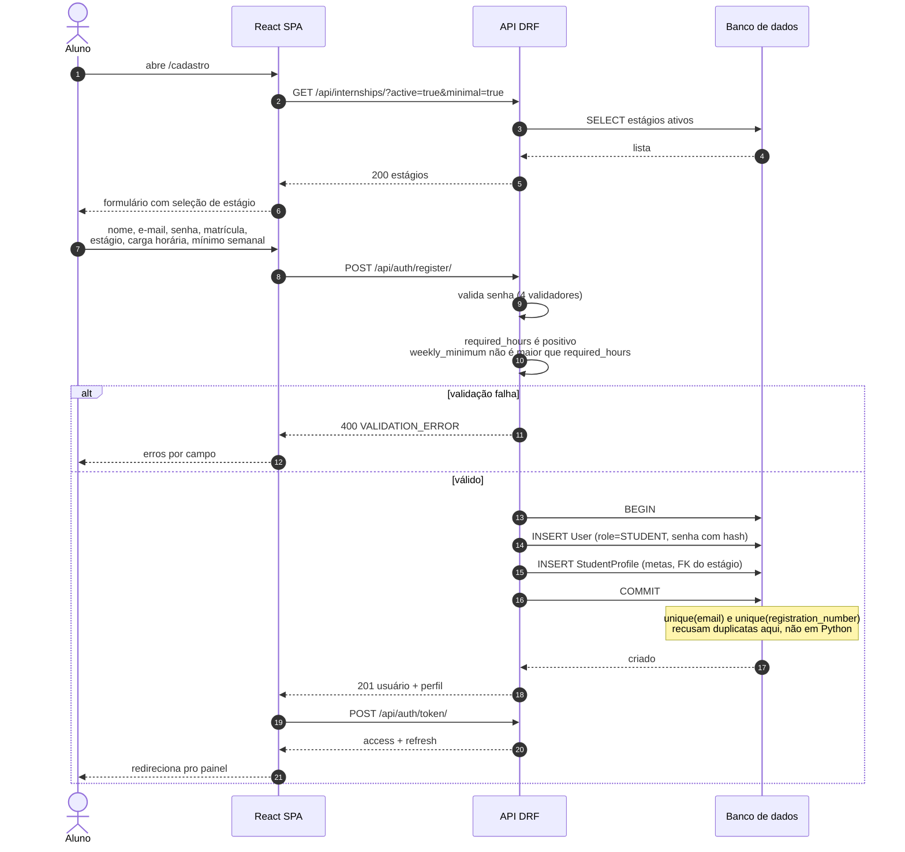
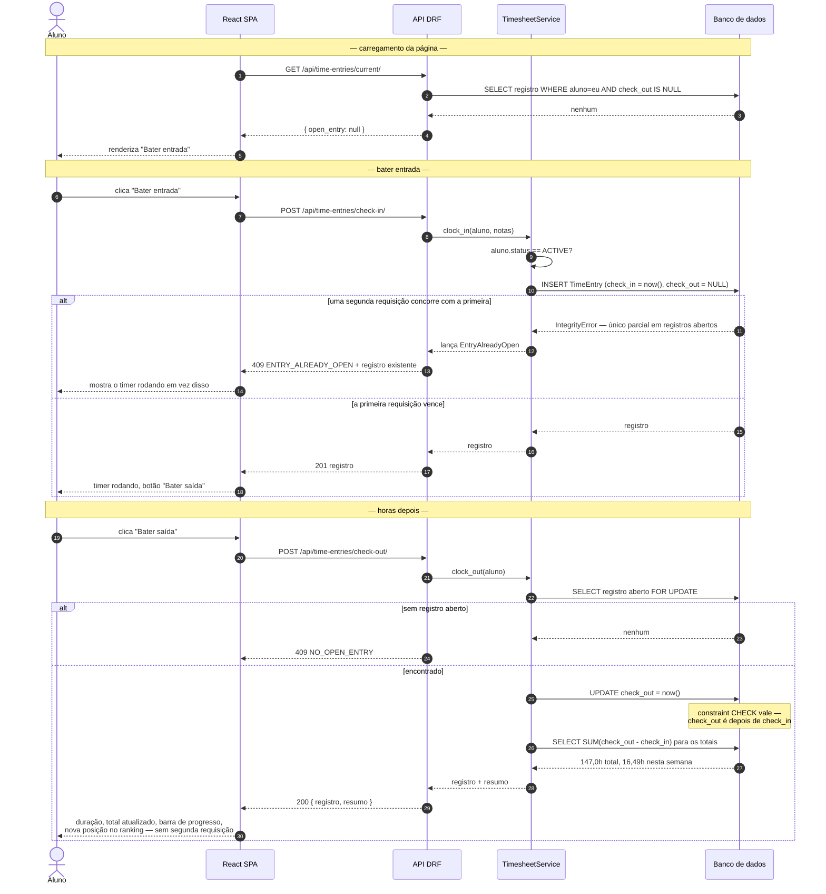
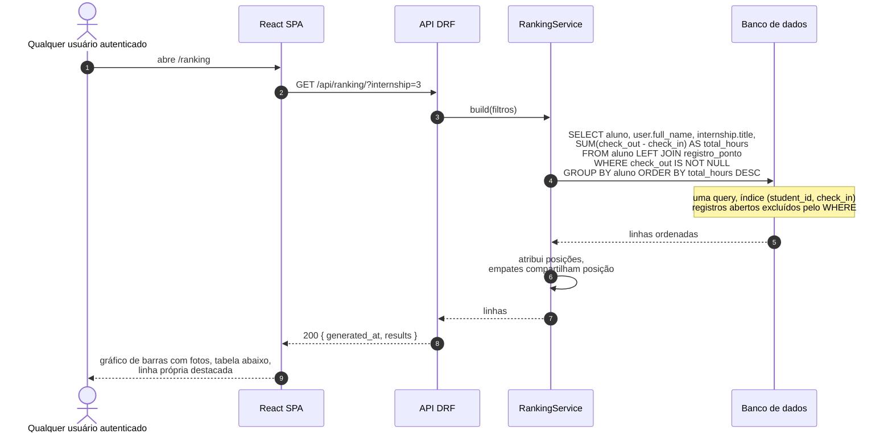
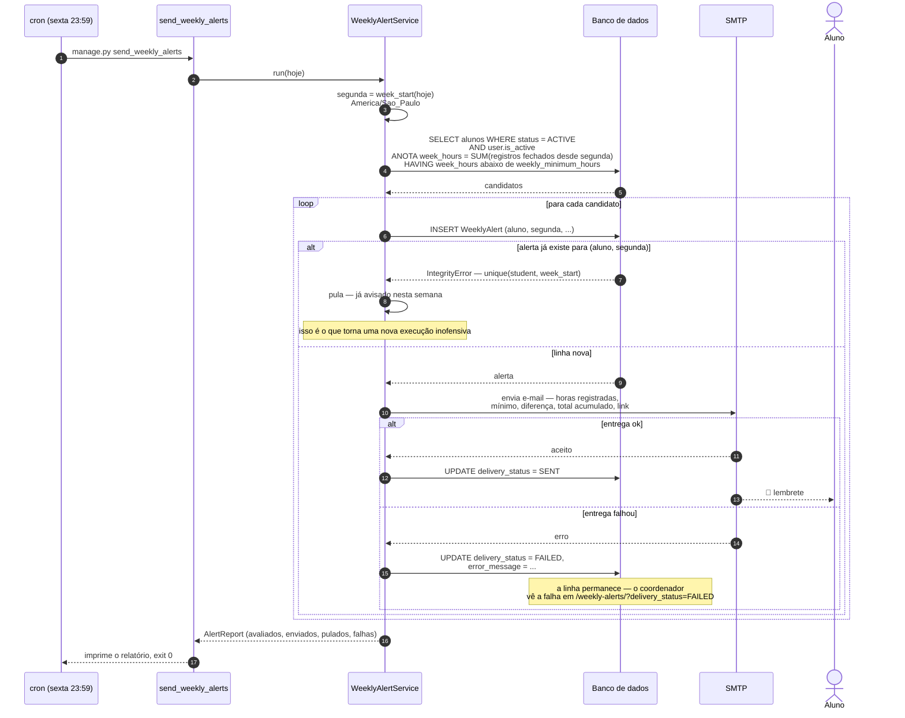
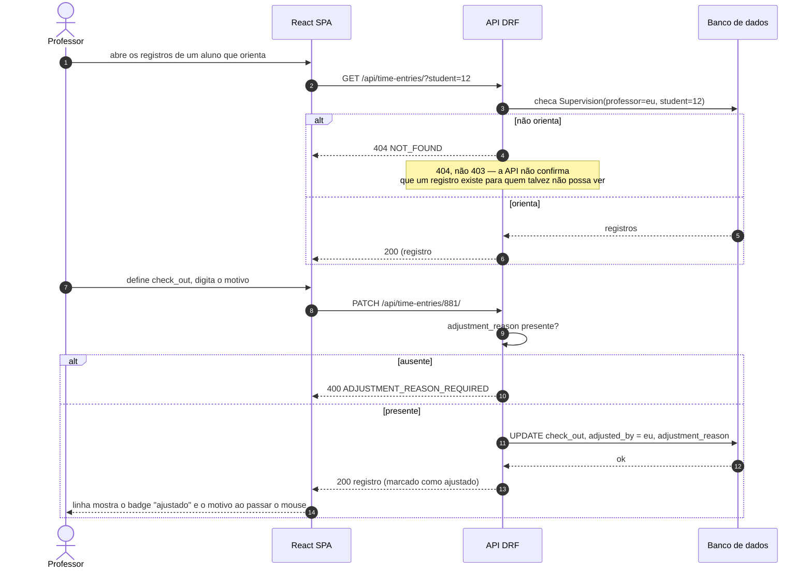

# Diagramas de Sequência

🇧🇷 **Português** | 🇺🇸 [English](../../diagrams/sequence-diagrams.md)

Os quatro fluxos que foram modelados antes da implementação.

---

## 1. Cadastro do aluno

O único fluxo onde `required_hours` e `weekly_minimum_hours` são coletados.

---

## 2. Bater entrada e saída

A interação central. Dois botões, e só um deles visível por vez.

---

## 3. Ranking

---

## 4. Alerta semanal — Sexta 23:59

O fluxo pelo qual o agendador inteiro existe.

**Por que a linha de `WeeklyAlert` é escrita antes do e-mail ser enviado:** a
constraint única precisa ser reivindicada primeiro. Se o e-mail saísse
primeiro e o processo morresse antes do insert, uma nova tentativa mandaria
e-mail duplicado pro aluno. Na outra ordem, uma queda deixa, no pior caso,
uma linha cujo `delivery_status` nunca saiu do valor inicial — visível,
corrigível, e não um duplicado na caixa de entrada de alguém.

---

## 5. Professor corrige um ponto esquecido

