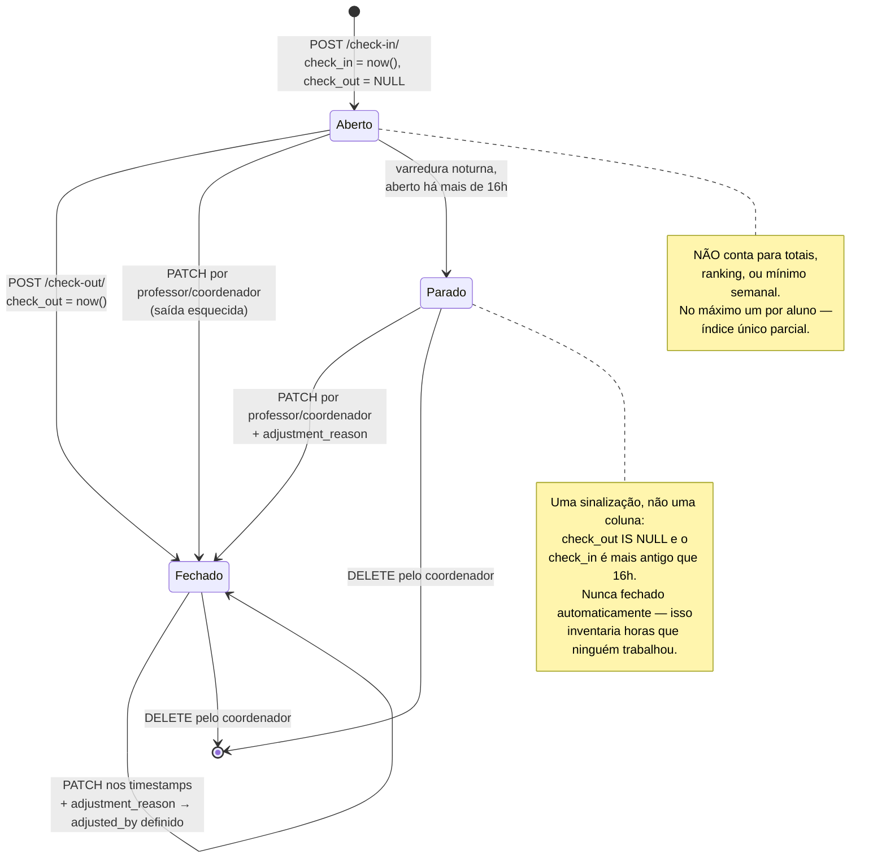
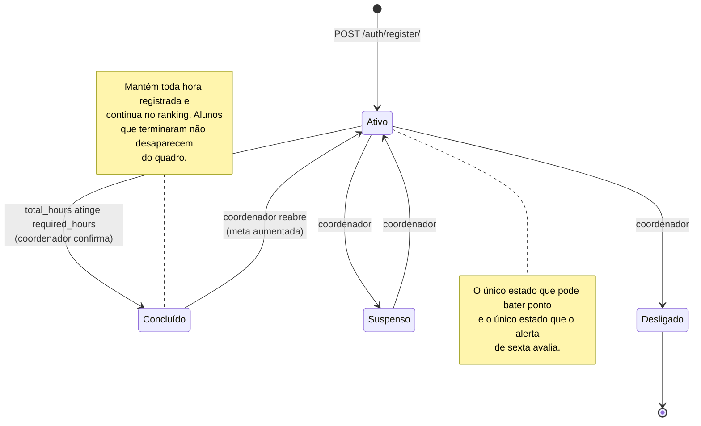
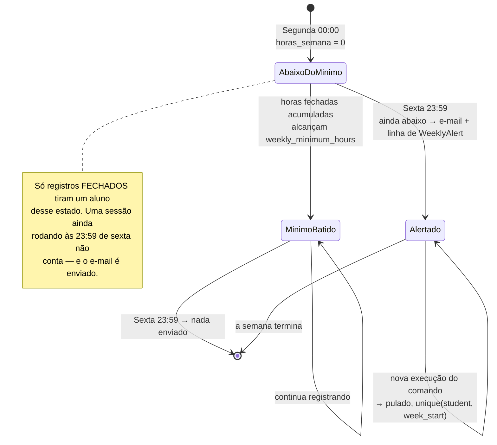

# Diagramas de Estado

🇧🇷 **Português** | 🇺🇸 [English](../../diagrams/state-diagram.md)

## TimeEntry

Um registro tem dois estados reais. O terceiro é uma sinalização, não um
estado — um registro ajustado continua fechado.

## StudentProfile

Atingir `required_hours` **não** muda o status automaticamente. Um
coordenador confirma isso, porque concluir um estágio é um ato administrativo
com papelada por trás, e as horas no sistema são evidência para essa decisão,
não a decisão em si.

## Ciclo de avaliação semanal

Onde um aluno se encontra dentro de uma semana, do ponto de vista do alerta.

